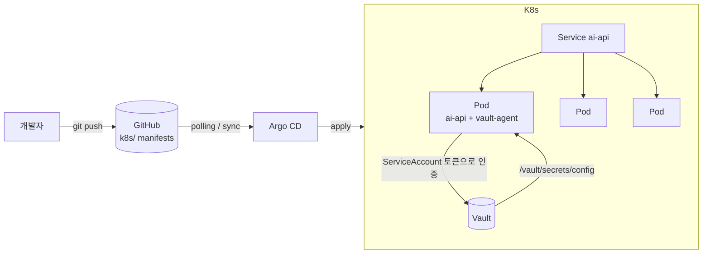

# ai-platform — FastAPI 서비스를 GitOps + Vault로 배포하기

Python(FastAPI) API 서비스를 Docker로 패키징하고, Kubernetes 위에 Argo CD(GitOps)로 배포하며,
API 키 같은 비밀값은 HashiCorp Vault에서 런타임에 주입받는 구조를 로컬에서 처음부터 끝까지 구축했다.
구축 후 장애 3종을 일부러 발생시켜 원인 추적·복구 과정을 기록했다.

환경: Windows 11 + WSL2(Ubuntu 24.04) + Docker Desktop(내장 Kubernetes v1.36) / Argo CD v3.5 / Vault 2.0 / Helm 3.22

## 아키텍처



| 기술 | 역할 | 해결한 문제 |
|---|---|---|
| Docker | `python:3.12-slim` 기반 이미지 `ai-api:v1` | 환경 차이 없는 패키징 |
| Kubernetes | Deployment(replicas 3) + Service, 라벨 `app: ai-api` | 자동 복구, 스케일링, 무중단 롤링 업데이트 |
| Argo CD | `k8s/` 폴더 감시, `automated + prune + selfHeal` | Git 커밋 = 배포. 수동 변경은 Git 기준으로 자동 복원 |
| Vault | KV v2 + Kubernetes 인증 + 읽기 전용 정책 + Agent Injector 사이드카 | K8s Secret은 base64일 뿐 암호화가 아님 |

앱 코드는 `os.getenv("AI_API_KEY")` 한 줄뿐이다. Vault 연동은 인프라 계층(annotation + 사이드카)에서 처리되어 **코드 수정 없이** 비밀 주입 방식을 바꿀 수 있다.

## 동작 확인

### 1. GitOps 배포 — kubectl 없이 커밋만으로 Pod 증가

`replicas: 2 → 3` 커밋 후. 세 번째 Pod(`5hgfg`)만 AGE가 다르다 — 이 시각에 실행한 명령은 `git push`뿐이다.

```
NAME                      READY   STATUS    RESTARTS   AGE
ai-api-5475664cbb-5hgfg   1/1     Running   0          74m
ai-api-5475664cbb-99l7q   1/1     Running   0          148m
ai-api-5475664cbb-jxkn8   1/1     Running   0          148m
```

### 2. selfHeal — 수동 변경을 Git 기준으로 자동 복원

```
$ kubectl scale deployment ai-api --replicas=1
deployment.apps/ai-api scaled
$ kubectl get pods -w
NAME                      READY   STATUS    RESTARTS   AGE
ai-api-5475664cbb-f4hjn   1/1     Running   0          2s
ai-api-5475664cbb-jxkn8   1/1     Running   0          149m
ai-api-5475664cbb-pfwb6   1/1     Running   0          2s
```

1개로 줄인 직후 2초 만에 Git에 선언된 3개로 복구됐다. Deployment가 아니라 Argo CD가 한 일이다 — Deployment 자체(replicas 값)가 바뀌었으므로 Deployment는 1개가 정상이라고 판단했기 때문.

### 3. Vault 주입 — 키는 Git / yaml / 이미지 어디에도 없다

Vault 설정:
```
$ vault kv put secret/ai-api AI_API_KEY=sk-vault-test-9999
=== Secret Path ===
secret/data/ai-api          ← KV v2는 경로에 data/가 끼어든다. 정책·annotation은 이 경로를 써야 한다
$ vault auth enable kubernetes
$ vault policy write ai-api -   # path "secret/data/ai-api" { capabilities = ["read"] }
$ vault write auth/kubernetes/role/ai-api bound_service_account_names=ai-api \
    bound_service_account_namespaces=default policies=ai-api ttl=24h
```

사이드카 주입 후 Pod가 `1/1 → 2/2`(앱 + vault-agent)로 바뀌고, 앱 컨테이너 안에 파일이 생긴다:
```
$ kubectl exec deploy/ai-api -c ai-api -- cat /vault/secrets/config
export AI_API_KEY="sk-vault-test-9999"
```

```
POST /analyze?text=text  →  200
{ "text_length": 4, "key_loaded": true }
```


## 장애 대응 기록

세 가지 장애를 **Git 커밋으로 발생시키고 Git 커밋으로 복구**했다.

```
da550d8 fix: correct vault role
89fe7a8 break: wrong vault role
f71accd fix: correct service selector
6cdff10 break: wrong service selector
3f27529 fix: revert image tag to v1
521c1b3 break: wrong image tag
6fc5018 feat: inject AI_API_KEY from Vault via agent sidecar
39b6f22 scale: replicas 2 -> 3
68a5a67 feat: Argo CD application
f743eab feat: FastAPI AI service + k8s manifests
```

### A. 이미지 태그 오타 → `ErrImageNeverPull`

`image: ai-api:v1 → v2`

```
$ kubectl describe pod ai-api-544d89d94d-nx5bt | tail -3
Normal   Started            2m12s  kubelet  spec.containers{vault-agent}: Container started
Warning  ErrImageNeverPull  9s (x11 over 2m12s)  kubelet  spec.containers{ai-api}: Container image "ai-api:v2" is not present with pull policy of Never
Warning  Failed             9s (x11 over 2m12s)  kubelet  spec.containers{ai-api}: Error: ErrImageNeverPull
```

- **확인 위치**: `describe pod` Events. Vault 사이드카는 정상 시작, `ai-api` 컨테이너만 실패했음이 바로 보인다.
- **배운 것**: 기존 Pod 3개는 그대로 `2/2 Running`이었다. 롤링 업데이트는 새 Pod가 준비될 때까지 기존 Pod를 유지한다 → **배포 실패 중에도 서비스 무중단.** `x11 over 2m12s`: 쿠버네티스는 포기하지 않고 backoff 재시도한다.

### B. Service selector 오타 → 배포 성공, 접속 불가

`selector: app: ai-api → ai-apii`

```
$ kubectl get pods
ai-api-757b79d94c-bkcrg   2/2     Running   0          37m
ai-api-757b79d94c-mhpf2   2/2     Running   0          37m
ai-api-757b79d94c-nv2m4   2/2     Running   0          37m
$ kubectl get endpointslice -l kubernetes.io/service-name=ai-api
NAME           ADDRESSTYPE   PORTS     ENDPOINTS   AGE
ai-api-l4bq4   IPv4          <unset>   <unset>     3h49m
$ kubectl port-forward svc/ai-api 8000:80
error: timed out waiting for the condition
```

- **확인 위치**: `endpointslice`. Pod는 전부 정상인데 Service가 보낼 곳이 없다.
- **배운 것**: `get pods`만 보면 "다 정상"으로 보인다. **배포 성공 ≠ 서비스 정상.** 접속 장애는 endpoints부터 확인한다. 또한 이미 열려 있던 `port-forward` 터널은 Pod에 직접 꽂혀 있어 계속 동작했다 — `port-forward`는 Service 경로 검증이 아니다.

### C. Vault role 오타 → Pod가 `Init:0/1`에서 정지

`vault.hashicorp.com/role: "ai-api" → "ai-apii"`

```
$ kubectl get pods
ai-api-86888d89b-h4jvd   0/2     Init:0/1   0          54s
$ kubectl describe pod ai-api-86888d89b-h4jvd | tail -2
Normal  Created  3m33s  kubelet  spec.initContainers{vault-agent-init}: Container created
Normal  Started  3m32s  kubelet  spec.initContainers{vault-agent-init}: Container started
$ kubectl logs ai-api-86888d89b-h4jvd -c vault-agent-init --tail=5
  | URL: PUT http://vault.default.svc:8200/v1/auth/kubernetes/login
  | Code: 400. Errors:
  | * invalid role name "ai-apii"
   backoff=46.66s
```

- **확인 위치**: `describe` Events에는 "init 컨테이너 시작됨"까지만 있고 원인이 없다. 원인은 **init 사이드카 로그**에 있다.
- **배운 것**: 사이드카 구조에서는 어느 컨테이너(`-c`)의 로그를 봐야 하는지 아는 것이 핵심. 로그 한 줄에 인증 흐름 전체(사이드카 → Vault 주소 → kubernetes auth → role 조회)가 드러난다.

### 구축 중 만난 장애

| 증상 | 원인 | 해결 |
|---|---|---|
| 첫 배포 `ErrImageNeverPull` | Docker Desktop(kind 방식) 노드와 로컬 Docker의 이미지 저장소가 분리 | `docker save ai-api:v1 \| docker exec -i desktop-control-plane ctr -n k8s.io images import -` |
| `bind: address already in use` (8080) | 이전 실습 nginx 컨테이너가 8080 점유, 브라우저가 그쪽에 붙어 `ERR_SSL_PROTOCOL_ERROR` | `ss -tlnp`, `docker ps`로 추적 → `docker stop` |
| push했는데 미반영, Argo는 `Synced` | `status.sync.revision`이 이전 커밋. **Synced = "Argo가 마지막으로 본 Git과 같다"**이지 최신 Git이 아님 | `argocd.argoproj.io/refresh=hard` annotation |
| 앱(8000) `ERR_SSL_PROTOCOL_ERROR` | Argo(8080, https)의 HSTS가 `localhost` 호스트 전체에 적용 | `127.0.0.1`로 접속 |
| `git commit` 거부 `empty ident name` | Git은 변경 주체를 반드시 기록 | `git config --global user.name/email` |

## 트러블슈팅 체크리스트

| 증상 | 먼저 볼 곳 |
|---|---|
| Pod Pending / ImagePull 에러 | `kubectl describe pod` Events |
| Pod Running인데 접속 불가 | `kubectl get endpointslice` (라벨 불일치) |
| Pod `Init:0/1` 정지 | `kubectl logs <pod> -c vault-agent-init` |
| push했는데 미반영 | Argo `status.sync.revision` vs `git log` |
| 앱 에러 | `kubectl logs <pod> -c ai-api` |
| 포트 안 열림 | `ss -tlnp \| grep <port>`, `docker ps` |

## 한계와 다음 단계

- Vault **dev 모드**(`Storage Type: inmem`, root 토큰 고정) — 운영에서는 Raft 스토리지, unseal 절차, root 토큰 폐기, 감사 로그
- 이미지가 로컬 노드에만 존재 — 컨테이너 레지스트리 + CI로 자동 빌드·푸시
- Argo CD 3분 폴링 의존 — GitHub Webhook으로 push 즉시 동기화
- `port-forward`로만 접속 — Ingress
- 관측성 없음 — Prometheus/Grafana로 Pod·endpoints 모니터링 (장애 B 자동 감지)

## 실행 방법

```bash
docker build -t ai-api:v1 .
docker save ai-api:v1 | docker exec -i desktop-control-plane ctr -n k8s.io images import -
kubectl create namespace argocd
kubectl apply -n argocd -f https://raw.githubusercontent.com/argoproj/argo-cd/stable/manifests/install.yaml
kubectl apply -f argocd/app.yaml          # 이후 배포는 Git push로만
helm install vault hashicorp/vault --set server.dev.enabled=true --set injector.enabled=true
kubectl exec -it vault-0 -- sh            # 위 "Vault 설정" 4단계 실행
kubectl port-forward svc/ai-api 8000:80   # http://127.0.0.1:8000/docs
```